# Evidências — Aula 1: repositório preparado

Registro das configurações aplicadas em 28/10/2026, conforme as seções 2, 3.2, 3.3 e 4.1
do [PGCS](../pgcs/PGCS.md). Todas foram conferidas pela API do GitHub após a configuração.

## 1. Recusa do push direto na `main`

Commit de teste feito diretamente na `main` local e enviado com `git push`:

```text
$ git push origin main
remote: error: GH006: Protected branch update failed for refs/heads/main.
remote:
remote: - Changes must be made through a pull request.
To https://github.com/Mendes006/controle-mudancas.git
 ! [remote rejected] main -> main (protected branch hook declined)
error: failed to push some refs to 'https://github.com/Mendes006/controle-mudancas.git'
```

O commit de teste foi descartado localmente; esta própria evidência entrou na `main` por
Pull Request com aprovação do par de revisão.

## 2. Proteção da `main` (PGCS 3.3 e 5.2)

| Regra | Valor |
|---|---|
| Require a pull request before merging | sim, **1** aprovação |
| Dismiss stale pull request approvals | sim |
| Require linear history | sim |
| Do not allow bypassing (inclui administradores) | sim |
| Force push / exclusão da branch | bloqueados |
| Required status checks | Aula 2 (os checks `ci-ok` e `titulo-pr` ainda não existem) |

## 3. Par de revisão (PGCS 2)

| Usuário | Permissão |
|---|---|
| [@cauepereira](https://github.com/cauepereira) | *Write* |

## 4. Merge (PGCS 3.3)

Somente **squash merge**, com título e descrição do PR como mensagem do commit; merge commit
e rebase merge desabilitados; branches apagadas automaticamente após o merge.

## 5. Environments (PGCS 3.2 e 6.1)

| Environment | Regras |
|---|---|
| `staging` | *Deployment branches*: somente branches protegidas |
| `production` | *Required reviewers*: [@Mendes006](https://github.com/Mendes006) (Desenvolvedor Líder); *Prevent self-review* desmarcado; somente branches protegidas |

## 6. Prints de cada etapa (28/10/2026)

### 6.1 Repositório público e estrutura (item 1 e 2)

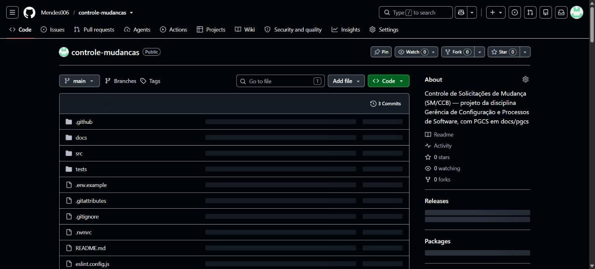

### 6.2 Proteção da `main` (item 3)

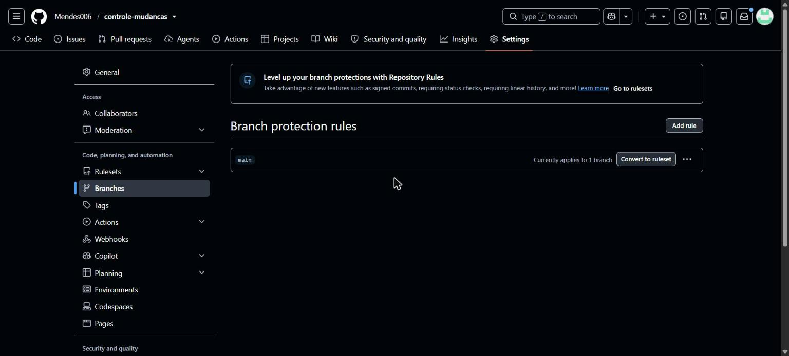

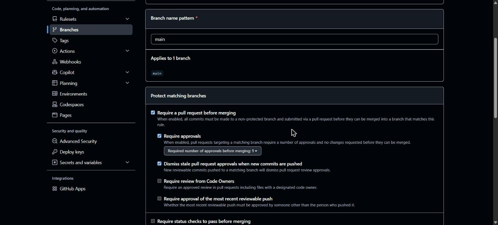

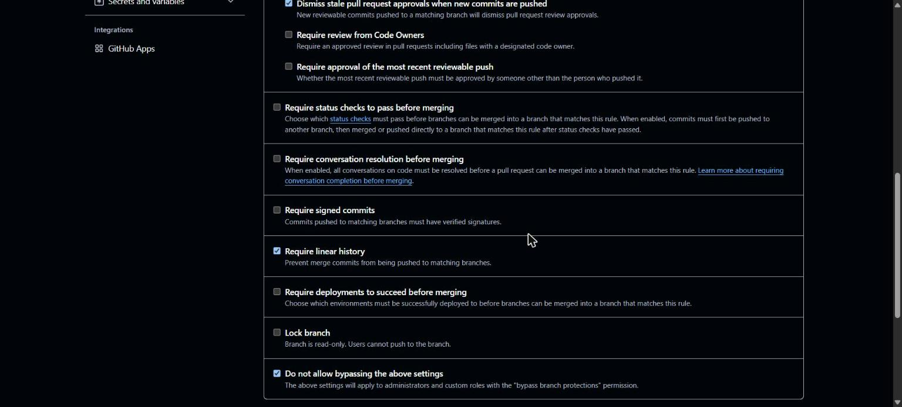

### 6.3 Recusa do push direto na `main` (item 3)

Nova tentativa feita em 28/10/2026 às 21:15:09; o commit de teste foi descartado localmente.

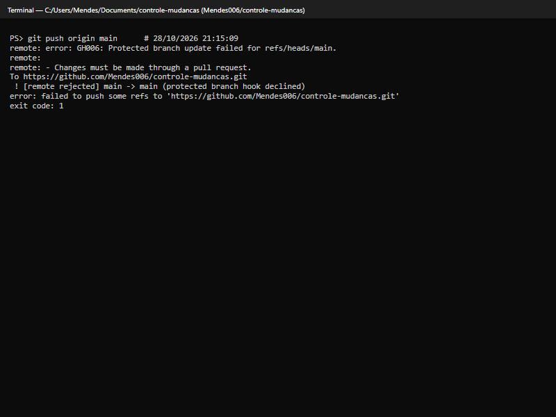

### 6.4 Par de revisão com acesso de escrita (item 4)

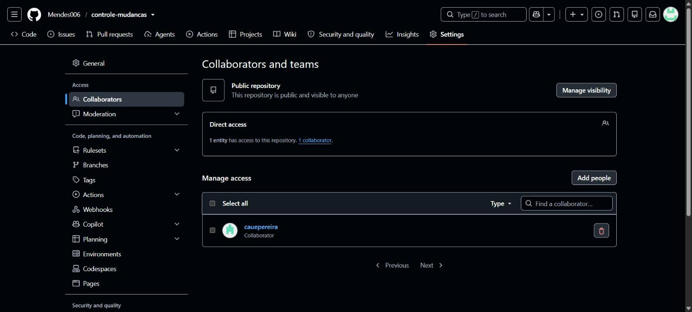

### 6.5 Merge somente por squash (PGCS 3.3)

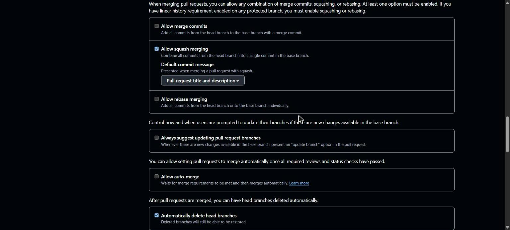

### 6.6 Environments (item 5)

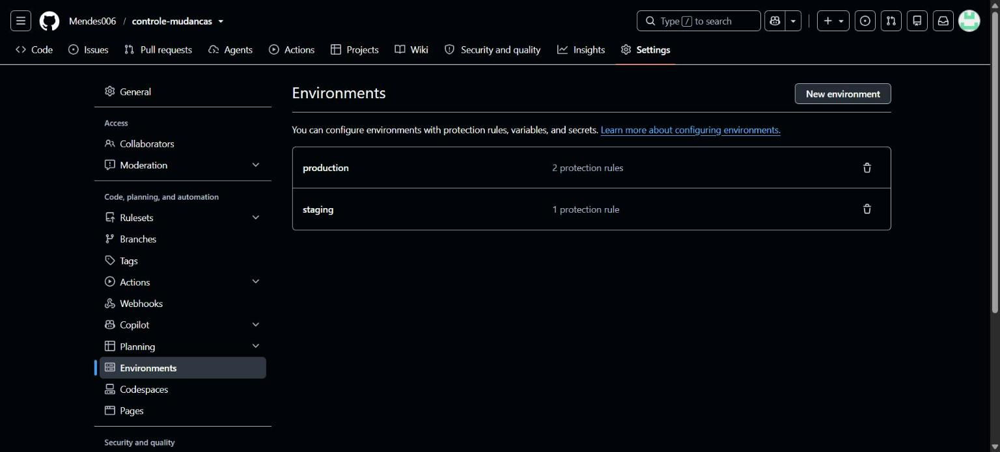

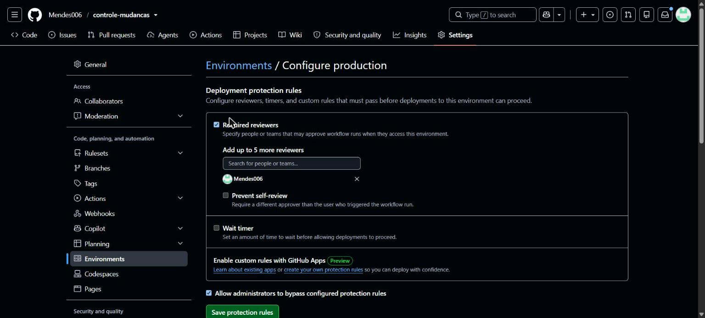

### 6.7 Fluxo de Pull Request com revisão do par

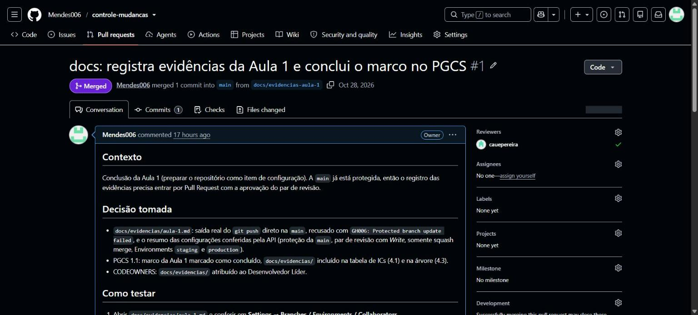

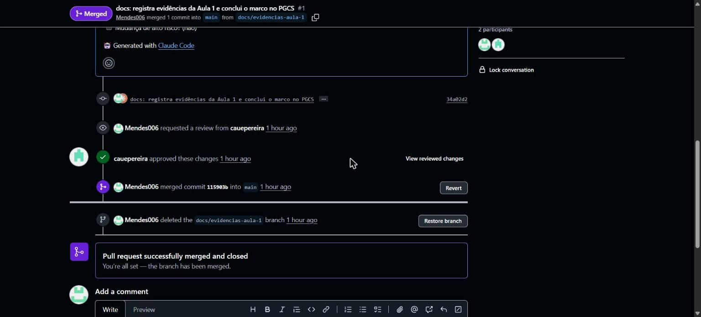

### 6.8 Aplicação em execução (ambiente local)

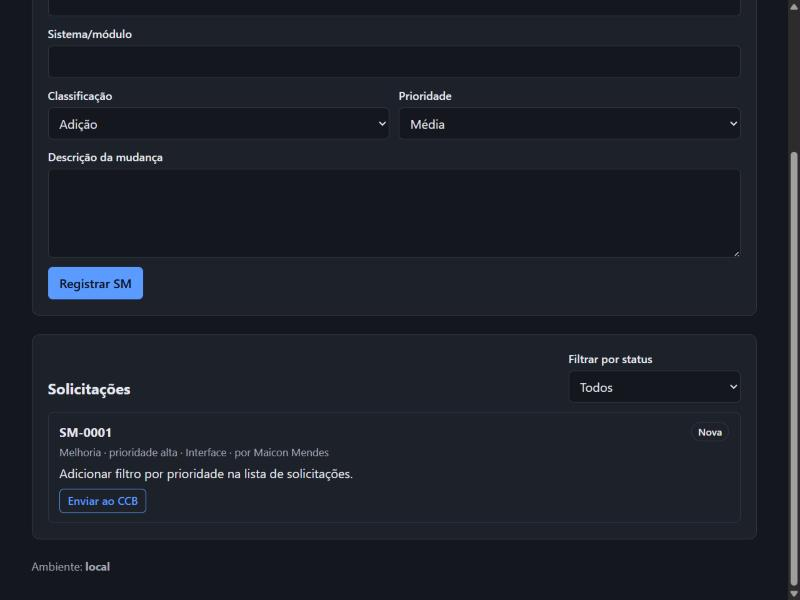
